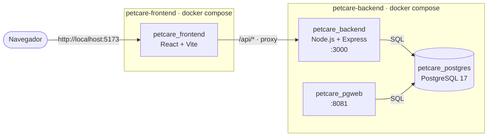
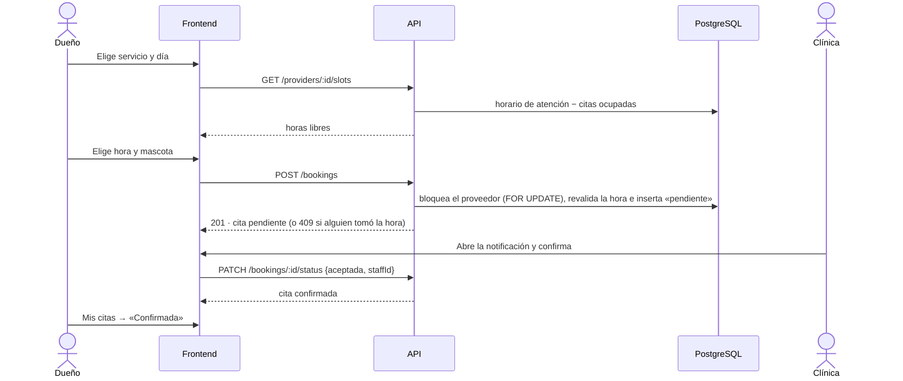
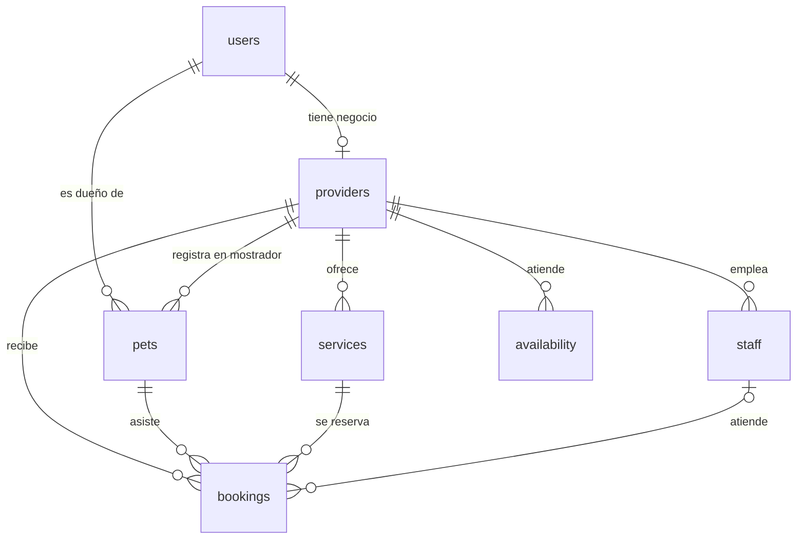

# Arquitectura de PetCare

[← Volver al README](../README.md)

## Componentes

| Contenedor | Imagen | Puerto | Función |
|---|---|---|---|
| `petcare_frontend` | `node:24-alpine` (construida) | 5173 | Sirve la aplicación React con Vite. Reenvía `/api/*` al backend, así que el navegador solo habla con un origen. |
| `petcare_backend` | `node:24-alpine` (construida) | 3000 | API REST. Al iniciar crea las tablas y, si la base está vacía, carga los datos de prueba. |
| `petcare_postgres` | `postgres:17-alpine` | interno | Base de datos. Los datos se guardan en el volumen `petcare_pgdata`. |
| `petcare_pgweb` | `sosedoff/pgweb` | 8081 (solo `127.0.0.1`) | Interfaz web para consultar la base de datos. |

- Los dos `docker-compose.yml` se comunican por la red `petcare_net`: la crea el backend y el frontend la usa
  como red externa.
- La API espera a que PostgreSQL esté listo gracias a su *healthcheck* y a reintentos de conexión.
- Toda la configuración se lee en un solo lugar, `src/config.js`. `src/app.js` registra las rutas desde una lista,
  así que un módulo nuevo se agrega en una línea.
- Zona horaria: **America/Bogota**. Las fechas de citas y los horarios libres se calculan con la hora de Colombia.

## Flujo de una reserva

## Modelo de datos

| Tabla | Qué guarda | Campos importantes |
|---|---|---|
| `users` | Cuentas de dueños y proveedores | `email` único, `password_hash` (bcrypt), `role` (`dueno` o `proveedor`), `document`, `phone`, `data_consent_at` (autorización según la Ley 1581 de 2012) |
| `providers` | Negocio de cada proveedor | `business_name`, `category` (veterinaria, peluquería, paseo, guardería), `locality`, `neighborhood`, `address`, `description` |
| `staff` | Profesionales del negocio | `name`, `specialty`, `active` |
| `pets` | Mascotas | Las crea el dueño (`owner_id`) o la clínica en el mostrador (`provider_id` + `owner_name` / `owner_phone`). `species`: perro, gato, conejo u otro |
| `services` | Servicios publicados | `price` (pesos), `duration_min` (15 a 600), `species` (arreglo de especies atendidas), `active` |
| `availability` | Horario semanal | `weekday` (0 = domingo … 6 = sábado), `start_time`, `end_time` |
| `bookings` | Citas | `booking_date`, `start_time`, `end_time`, `price` (se copia al reservar), `status`, `urgent`, `staff_id`, notas del dueño y del proveedor |

El esquema completo está en [petcare-backend/src/schema.sql](../petcare-backend/src/schema.sql) y los datos de
prueba en [petcare-backend/src/seed.js](../petcare-backend/src/seed.js).

## Reglas de negocio

### Horarios y reservas

- Las horas libres se ofrecen **cada 30 minutos**. La cita debe caber completa dentro del horario de atención
  del día.
- Una hora está ocupada si se cruza con otra cita **pendiente, confirmada o atendida** del mismo proveedor.
  Las citas canceladas o rechazadas liberan el horario.
- No se puede reservar en el pasado. Para el día de hoy se exige una anticipación mínima de 30 minutos.
- Antes de guardar, la API **bloquea al proveedor** (`SELECT … FOR UPDATE`) y vuelve a validar la hora. Así,
  dos personas que reservan la misma hora al mismo tiempo no pueden tomarla las dos: una recibe `409`.
- El servicio debe atender la especie de la mascota.

### Estados de una cita

| Estado (en pantalla) | Valor en la base | Lo cambia |
|---|---|---|
| Pendiente | `pendiente` | Lo crea el dueño al reservar |
| Confirmada | `aceptada` | El proveedor confirma una pendiente, o la clínica crea la cita directamente |
| Atendida | `atendida` | El proveedor, desde una confirmada, **solo el día de la cita o después** |
| Rechazada | `rechazada` | El proveedor, desde una pendiente |
| Cancelada | `cancelada` | El proveedor desde una confirmada, o el dueño desde una pendiente o confirmada **que no haya pasado** |

Atendida, Rechazada y Cancelada son estados finales.

### Clínica

- **Nueva cita:** queda confirmada. La hora se elige libremente, pero se valida que esté dentro del horario y no
  se cruce con otra cita.
- **Cita urgente:**
  - Registra la mascota con los datos del propietario y busca el primer espacio libre en los próximos 7 días.
  - Usa una consulta del proveedor que atienda esa especie.
  - Asigna el primer profesional activo, con preferencia por medicina general.
- **Fichas de pacientes:**
  - La clínica solo edita las mascotas que ella misma registró.
  - Las mascotas de dueños con cuenta las actualiza su dueño.
- **Servicios:** un servicio que ya tiene reservas no se borra, se desactiva, para conservar el historial.
- **Horario:** no se permiten franjas que se crucen en el mismo día.

### Dueño

- Solo ve y reserva con sus propias mascotas.
- No puede eliminar una mascota con citas pendientes o confirmadas, ni una con historial de atenciones, para no
  borrar la historia clínica ni los reportes de la clínica.

## Seguridad

- Contraseñas guardadas con **bcrypt**. Mínimo 8 caracteres, con letras y números.
- Sesión con **JWT** (8 horas por defecto), firmada con `JWT_SECRET`. Para generar una clave propia, siga el
  [paso a paso del README](../README.md#52-generar-la-clave-secreta-jwt_secret-paso-a-paso).
  - Con «Recordarme» marcado, el token se guarda en `localStorage`; si no, en `sessionStorage` y se borra al
    cerrar el navegador.
- **Roles:**
  - La API verifica el rol en cada ruta: un dueño no puede usar rutas de la clínica, y al revés.
  - Cada consulta filtra por el usuario o el proveedor de la sesión, así que nadie ve ni modifica datos de otros.
- **Validación en dos niveles:**
  - La interfaz muestra los errores campo por campo.
  - La API valida de nuevo y responde `400` con `details` por campo.
- Todas las consultas SQL usan parámetros (`$1`, `$2`…), no texto concatenado.
- pgweb solo escucha en `127.0.0.1`.
